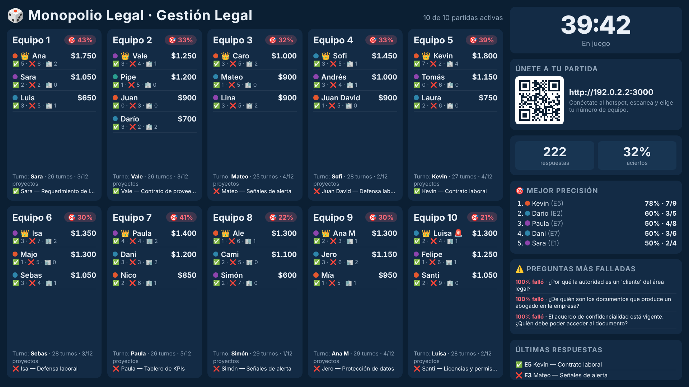
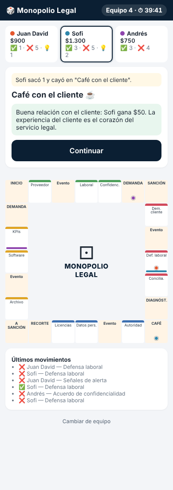

# 🎲 Monopolio Legal

Juego didáctico para aprender **Gestión Legal (Legal Operations)** jugando, hecho para la asignatura **Gestión de Proyectos** (Universidad de Caldas) por el **Equipo 4 – Gestión Legal**.

Es un Monopolio donde las propiedades son **proyectos legales**: para comprarlos, defenderlos y mejorarlos hay que responder preguntas. Cada respuesta, buena o mala, muestra la explicación, así que se aprende aunque no se sepa nada del tema.

- 💻 Un computador es el **servidor** (sin internet, solo red local).
- 📱 Cada equipo juega **su propia partida** desde **un celular** (los integrantes se turnan).
- 📺 Un **dashboard en el TV** muestra en vivo cómo va cada equipo, quién gana, quién responde mejor y qué preguntas se fallan más.
- 📊 Todas las respuestas quedan registradas y se exportan a **Excel (CSV)**.

| Dashboard del TV | Celular del equipo |
|---|---|
|  |  |

---

## 🚀 Probarlo en 3 minutos (en tu computador)

**Requisito:** [Node.js](https://nodejs.org) versión 18 o superior (descarga la **LTS**).

```bash
git clone https://github.com/JuanGonzalezx/monopolio-legal.git
cd monopolio-legal
npm install
npm start
```

Se abre el servidor y en la terminal verás algo así:

```
🎲  MONOPOLIO LEGAL listo
Celulares:   http://192.168.43.20:3000
TV:          http://localhost:3000/tv
Moderador:   http://localhost:3000/admin   (PIN: 1234)
```

Luego:

1. Abre **http://localhost:3000/admin**, escribe el PIN **1234** y presiona **▶️ Iniciar**.
2. Abre **http://localhost:3000/tv** para ver el dashboard.
3. Abre **http://localhost:3000** (en otra pestaña o en tu celular conectado a la misma red) para jugar: elige un equipo, escribe 2 a 4 nombres y juega.

> **Atajo:** en macOS puedes dar doble clic a `iniciar.command`; en Windows, a `iniciar.bat`. Instalan las dependencias la primera vez y arrancan el servidor.

### Ver el dashboard lleno sin 10 celulares

Con el servidor corriendo, abre **otra terminal** en la misma carpeta y ejecuta:

```bash
npm run simular
```

Simula 10 equipos respondiendo al azar durante 45 segundos (`EQUIPOS=5 SEGUNDOS=90 npm run simular` para cambiarlo). Míralo en `/tv` y `/admin`. Para limpiar: moderador → **🗑 Reiniciar todo**.

---

## 🏫 Montaje el día de la clase

| Elemento | Rol |
|---|---|
| Mac / PC | Servidor del juego + dashboard por HDMI al TV |
| Celular con hotspot | Crea la red local (no consume datos: el juego no usa internet) |
| 1 celular por equipo | Juega su partida |

1. **Hotspot:** preferible **Android** (red `192.168.x.x`, clase C, admite más dispositivos). El iPhone usa `172.20.10.x/28` y admite ~13 dispositivos. Sube el límite de conexiones del hotspot al máximo.
2. Conecta el computador al hotspot y ejecuta `npm start` (o el `iniciar`).
3. Proyecta **`/tv`** en el TV a pantalla completa. El TV muestra un **QR** con la dirección correcta.
4. Cada equipo se conecta al hotspot, **escanea el QR**, elige su número y escribe los nombres.
5. Moderador (`/admin`) → **Iniciar** (40 min por defecto).

> ⚠️ **Antes de la clase prueben con 3–4 celulares.** Algunos hotspots aíslan a los dispositivos entre sí: si ningún celular abre la página, usen otro celular o un router.
> La primera vez, macOS/Windows pedirá permitir conexiones entrantes para Node: acepten.

---

## 🎮 Cómo se juega

- Cada jugador empieza con **$1.000**; se tira **un dado** y se avanza por un tablero de **24 casillas**. Pasar por Inicio: **+$200**.
- **12 proyectos** en 4 áreas: Contratos ($100), Litigios ($150), Cumplimiento ($200) e Información y tecnología ($250).
- Cada proyecto tiene **3 cartas**:

| Carta | Cuándo | Qué pasa |
|---|---|---|
| **A · Adquirir** | Caes en un proyecto libre | Si aciertas, puedes comprarlo |
| **B · Ejecutar** | Caes en el proyecto de otro | Responde el **dueño**: si acierta, le pagas honorarios; si falla, tú respondes la carta C y si aciertas **te lo quedas** |
| **C · Mejorar** | Caes en tu proyecto | Si aciertas y pagas $100, construyes una oficina. Con **2 oficinas** queda **blindado** 🛡️ |

- **Honorarios:** la mitad del precio; ×2 si tienes el área completa; ×2 con 1 oficina y ×3 con 2.
- **Casillas especiales:** Demanda (intentas quitarle un proyecto a otro), Diagnóstico (comodín 💡 PISTA que elimina una opción), Recorte de presupuesto, Vaya a Sanción (cárcel), Café con el cliente y **Eventos del director** (renuncia de Martínez, dato urgente, software milagroso, "stopper"…).
- **Gana** el de mayor **patrimonio**: dinero + valor de proyectos + $100 por oficina.

Las reglas completas están en [`docs/Monopolio_Legal_Documentacion.docx`](docs/Monopolio_Legal_Documentacion.docx).

---

## 🛠️ Panel del moderador (`/admin`, PIN 1234)

- Iniciar, pausar, reanudar, +5 min y terminar el juego.
- Ver cada partida, corregir dinero, saltar turno o borrar una partida.
- **Trazabilidad:** tabla con todas las respuestas (quién, qué pregunta, qué respondió, cuál era la correcta), con filtros.
- **⬇️ Descargar CSV** para Excel.
- Recargar `preguntas.json` sin reiniciar.

## ✏️ Editar las preguntas

Todas están en [`data/preguntas.json`](data/preguntas.json):

```json
{ "q": "¿Qué es un KPI?",
  "o": ["Un tipo de demanda", "Un indicador que mide el desempeño", "Un software legal"],
  "a": 1,
  "e": "Los KPIs miden el desempeño del área legal." }
```

`q` pregunta · `o` 3 opciones · `a` índice de la correcta (0, 1 o 2) · `e` explicación. Las opciones se barajan solas. Después de editar: moderador → **↻ Recargar preguntas.json**.

---

## ⚙️ Configuración opcional

```bash
ADMIN_PIN=9999 PORT=8080 EQUIPOS=12 npm start
```

| Variable | Por defecto | Para qué |
|---|---|---|
| `ADMIN_PIN` | `1234` | PIN del moderador |
| `PORT` | `3000` | Puerto del servidor |
| `EQUIPOS` | `10` | Número de partidas |
| `URL` | automática | Forzar la dirección que muestra el QR |

En Windows (PowerShell): `$env:ADMIN_PIN="9999"; npm start`

## 🧱 Tecnologías

**Node.js** (servidor HTTP nativo) · **Socket.IO** (tiempo real) · **HTML/CSS/JS** sin frameworks · **qrcode**. El estado se guarda en `data/partida.json`: si el servidor se cierra, al volver a abrirlo la partida sigue donde iba.

```
monopolio-legal/
├── server.js            # servidor y reglas del juego
├── public/
│   ├── index.html       # vista del celular
│   ├── tv.html          # dashboard del TV
│   └── admin.html       # panel del moderador
├── data/preguntas.json  # banco de preguntas
├── scripts/simular.js   # simulador de equipos para pruebas
├── docs/                # documentación y propuesta de juegos
├── iniciar.command      # inicio rápido macOS
└── iniciar.bat          # inicio rápido Windows
```

## ❓ Problemas comunes

| Problema | Solución |
|---|---|
| `npm: command not found` | Instala Node.js LTS y abre una terminal nueva |
| El celular no abre la página | Verifica que esté en la **misma red** y usa la IP que muestra el TV/terminal (no `localhost`) |
| Ningún celular abre | El hotspot aísla clientes: prueba otro celular o un router |
| `EADDRINUSE` (puerto ocupado) | Ya hay un servidor abierto; ciérralo o usa `PORT=3001 npm start` |
| Quiero empezar de cero | Moderador → **🗑 Reiniciar todo** (o borra `data/partida.json`) |

---

Hecho por el **Equipo 4 – Gestión Legal** · Gestión de Proyectos · Universidad de Caldas · 2026
